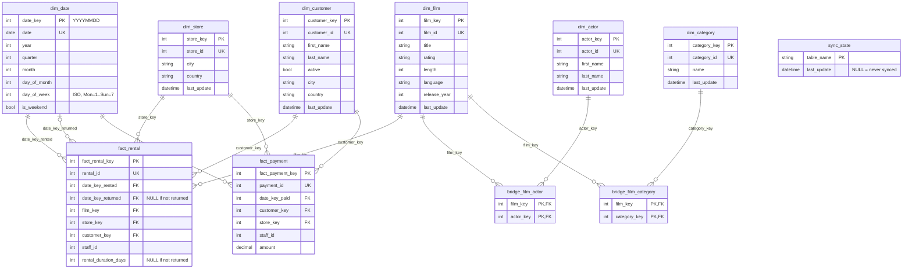

# README

A small data sync that reads the Sakila sample database through an ORM and writes a star schema (dimensions, bridges, facts) into a SQLite file, also through the ORM. It supports a full load, timestamp-driven incremental updates, and a validation command.

## Stack

| Component | Version |
|---|---|
| Python | 3.9.6 |
| ORM | SQLAlchemy 2.0.57 (2.x style: `DeclarativeBase`, `Mapped`, `select()`) |
| MySQL driver | PyMySQL 1.2.3 (+ cryptography 50.0.2 for MySQL 8 authentication) |
| Source | MySQL 8.0.46 in Docker, official Sakila sample database |
| Target | SQLite 3.51.0 (bundled with Python) |
| Tests | pytest 8.4.2 |
| Config | python-dotenv 1.2.1 |

## Project layout

```
sakila_sync/
  config.py          environment variables -> connection URLs
  db.py              two engines and two session factories (MySQL source, SQLite target)
  source_models.py   ORM models for the 15 Sakila tables
  target_models.py   ORM models for the analytics tables and their indexes
  dates.py           date_key and dim_date attributes
  init_db.py         init command
  sync.py            full-load and incremental (one shared code path)
  validate.py        validate command
  cli.py             argument parsing, logging, error handling, exit codes
tests/
  conftest.py        resets sakila_test, points each test at its own SQLite file
  test_sync.py       the five tests
sql/                 official Sakila dump (schema + data)
docker-compose.yml   MySQL 8.0 container
```

## Setup

Requires Docker and Python 3.9+.

```bash
# 1. Credentials
cp .env.example .env              # then set MYSQL_PASSWORD in .env

# 2. MySQL with Sakila
docker compose up -d              # wait ~20 s for MySQL to start
set -a; source .env; set +a
export MYSQL_PWD="$MYSQL_PASSWORD"
cat sql/sakila-schema.sql sql/sakila-data.sql | docker exec -i -e MYSQL_PWD sakila-mysql mysql -uroot

# 3. Python
python3 -m venv .venv
source .venv/bin/activate
pip install -r requirements.txt
```

The test database `sakila_test` does not need to be created by hand: the tests rebuild it from `sql/` at the start of every run.

### Environment variables

All connection settings come from the environment. `.env` is git-ignored; `.env.example` lists the variables without secrets. Variables already set in the shell take precedence over `.env`.

| Variable | Example | Used for |
|---|---|---|
| `MYSQL_HOST` | `127.0.0.1` | MySQL host |
| `MYSQL_PORT` | `3307` | MySQL port (also the host port Docker publishes) |
| `MYSQL_USER` | `root` | MySQL user |
| `MYSQL_PASSWORD` | – | MySQL password (also the container's root password) |
| `MYSQL_DATABASE` | `sakila` | source database |
| `MYSQL_TEST_DATABASE` | `sakila_test` | database the tests reset and modify |
| `SQLITE_PATH` | `analytics.db` | target SQLite file |

## Commands

```bash
python -m sakila_sync init
python -m sakila_sync full-load
python -m sakila_sync incremental
python -m sakila_sync validate [--from YYYY-MM-DD] [--to YYYY-MM-DD]
```

Each command logs what it does, ends with `<command> completed successfully` or `<command> failed: <reason>`, and exits with 0 on success and 1 on failure. A configuration or database error prints a one-line message. Any other error prints a full traceback, because it is a bug.

- **init** checks the MySQL connection (it counts the films), creates the SQLite file and all tables from the ORM models, fills `dim_date` with every day from the first to the last date in Sakila's rentals and payments, and adds one `sync_state` row per source table with an empty marker. It can be rerun: existing tables, dates and markers are left alone.
- **full-load** loads every row, then runs `validate` on the default period.
- **incremental** loads only rows changed since the markers, then runs `validate`. It refuses to run before a full-load.
- **validate** compares MySQL and SQLite. The default period is the 30 days ending on the latest payment date in Sakila (2006-01-16 to 2006-02-14 on the original data).

## How the sync works

### One code path for both loads

For each analytics table there is one extract query on Sakila. Its `WHERE` clause keeps the rows where the table's own `last_update`, or the `last_update` of any related table that feeds one of its columns, is `>=` that table's marker. full-load passes no markers, so the condition is always true. incremental passes the markers from `sync_state`.

| Target table | Source tables watched |
|---|---|
| `dim_film` | film, language |
| `dim_actor` | actor |
| `dim_category` | category |
| `dim_store` | store, address, city, country |
| `dim_customer` | customer, address, city, country |
| `bridge_film_actor` | film_actor |
| `bridge_film_category` | film_category |
| `fact_rental` | rental, inventory (film and store of the copy) |
| `fact_payment` | payment, rental, inventory, staff (they decide the store) |

Using `last_update` and not `rental_date` matters: returning a rental changes `return_date` and `last_update`, never `rental_date`.

### Upserts, Type 1

Every write is `INSERT ... ON CONFLICT (natural key) DO UPDATE`, built with SQLAlchemy's SQLite dialect (`sqlalchemy.dialects.sqlite.insert(...).on_conflict_do_update`). A changed source row overwrites the existing analytics row, so dimensions always show the latest values and surrogate keys never change. Rows read twice (because of `>=`) are overwritten with the same values, so reruns never create duplicates. Bridges have no non-key columns, so they use `ON CONFLICT DO NOTHING`. Rows are written in chunks of 1000 to stay under SQLite's limit on bound parameters per statement.

`session.merge()` is not used for the analytics tables because it matches on the primary key, which is the surrogate key. The sync only knows the natural key.

### Order and transactions

Dimensions are loaded first, then bridges, then facts. Before a fact is written, its natural keys are mapped to surrogate keys with a lookup (`{film_id: film_key}` read from SQLite), and any new date is added to `dim_date`. If a lookup fails because a dimension row is missing, the run stops and the transaction is rolled back. `validate` also checks for fact rows without a matching dimension row.

Each run uses one MySQL transaction and one SQLite transaction. Under MySQL's default REPEATABLE READ isolation, every query in the run sees the same snapshot. The SQLite transaction is committed only after every table and the new markers are written. On any error it is rolled back, so the analytics database stays as it was.

### Markers (`sync_state`)

`sync_state` has one row per source table: `table_name` and `last_update`. `NULL` means the table has never been synced. At the end of a run, the marker for each table is set to `MAX(last_update)` of that table, read in the same snapshot as the data. I use the source's own maximum and not the clock of the machine running the sync, so a clock difference between the two machines cannot cause skipped rows.

In the original dump almost every row of a table has the same `last_update`, so an incremental run right after a full-load reads most rows again (they are all `>=` the marker). This is expected with `>=`. After real changes the markers move to the new timestamps and only those rows are read.

## Validation

`validate` runs these checks; each prints `OK` or `MISMATCH`:

1. Row counts for every dimension, bridge and fact against its source table (whole database).
2. Rentals per store in the period.
3. Payments per store in the period: count, and total amount within $0.01.
4. Rentals and payments of the period that are missing from SQLite.
5. Duplicate natural keys in SQLite.
6. Fact and bridge rows whose key has no dimension row.

Any mismatch makes the command exit with 1 and the message `validate failed: N check(s) failed`.

## Tests

```bash
docker compose up -d          
python -m pytest -v
```

The tests never touch `sakila`. At the start of each run, `conftest.py` drops and recreates `sakila_test` from `sql/`. Each test gets its own SQLite file in a temporary folder. A guard refuses to run if `MYSQL_TEST_DATABASE` equals `MYSQL_DATABASE`.

| Test | What it checks |
|---|---|
| `test_init_creates_database_and_tables` | `init` exits 0, the file exists, all 11 tables exist, `dim_date` is filled, `sync_state` has 15 rows |
| `test_full_load_copies_all_data` | every table's row count matches Sakila; the assignment's example rows (film 141, rentals 3818 and 11496 with NULLs); every marker is set |
| `test_incremental_picks_up_new_rows` | a new rental and two payments in Sakila appear in SQLite; the new date is added to `dim_date`; the payment is attributed to the copy's store, and the payment without a rental to the staff member's store; a second run adds no duplicates |
| `test_incremental_applies_updates` | returning rental 11496 sets `date_key_returned` and the duration; moving customer 97 to another address updates city and country; renaming only the `city` row of customer 155 updates `dim_customer` |
| `test_validate_passes_then_reports_mismatch` | `validate` passes on the default period; after changing one payment amount in SQLite, it fails and logs `MISMATCH amount in period` |

Sakila has `BEFORE INSERT` triggers that replace `rental_date` and `payment_date` with `NOW()`. The insert test therefore writes its dates again with an ORM update after the insert.

## Analytics schema (ER diagram)



## Indexes

All indexes are declared in the ORM models (`target_models.py`) and created by `init` through `create_all`.

| Index | Table(s) | Why |
|---|---|---|
| `ux_dim_film_film_id`, `ux_dim_actor_actor_id`, `ux_dim_category_category_id`, `ux_dim_store_store_id`, `ux_dim_customer_customer_id` | dimensions | Unique index on the natural key. It is the conflict target of the upsert (`ON CONFLICT (film_id)` only works with a unique index on that column), it makes duplicate natural keys impossible, and it speeds up the natural key → surrogate key lookup. |
| `ux_fact_rental_rental_id`, `ux_fact_payment_payment_id` | facts | Same role for the facts: upsert target, and no rental or payment can be loaded twice. |
| primary key `(film_key, actor_key)`, `(film_key, category_key)` | bridges | The composite primary key is the bridge's unique index: no pair is stored twice, and it is the upsert target. |
| `ix_fact_rental_date_key_rented`, `ix_fact_rental_date_key_returned`, `ix_fact_payment_date_key_paid` | facts | Filters and joins by date. `validate` filters every period check on these columns. |
| `ix_fact_rental_film_key`, `ix_fact_rental_store_key`, `ix_fact_rental_customer_key`, `ix_fact_payment_store_key`, `ix_fact_payment_customer_key` | facts | Joins from a fact to its dimensions and group-bys per store, film or customer (for example revenue per store). |
| primary key `date_key`, unique `date` | dim_date | `date_key` is the join target of every fact date column; the unique `date` prevents two keys for the same day. |

## raw SQL

Everything that reads or writes data, creates tables or creates indexes goes through SQLAlchemy. The sync code itself contains no raw SQL. Raw SQL is used in one place only:

**Loading the official Sakila dump** (setup step 2, and `reset_test_database()` in `tests/conftest.py`). The dump creates tables, views, triggers and stored routines; the ORM cannot execute a multi-statement script with `DELIMITER` blocks. It is piped into the `mysql` client inside the container. The test data itself (new and changed rows) is written with the ORM.


